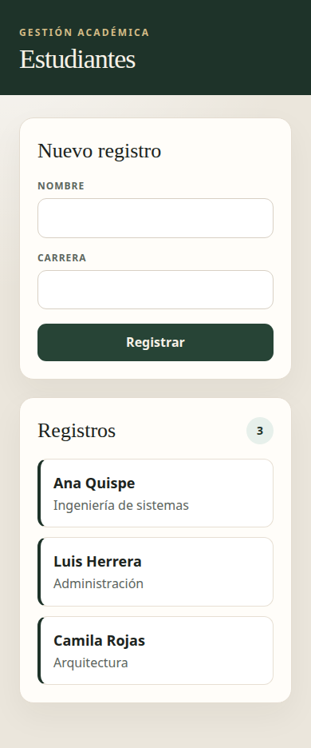

# Gestión académica

Registro de estudiantes con React. El proyecto está en la carpeta `gestion-academica`.

## Cómo ejecutarlo

Se necesita Node.js 20 o superior.

```bash
cd gestion-academica
npm install
npm run dev
```

Abrir en el navegador la dirección que muestra la terminal. Normalmente es http://localhost:5173

## Capturas

Al abrir:


Después de registrar:


En una pantalla estrecha:


